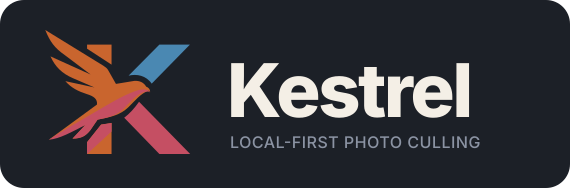

# Kestrel brand kit

A right-facing kestrel crosses a split K. The copper wing and wine-crimson underside sit between the dusk-blue and wine diagonals. The mark uses flat vector shapes and retains the swept wing and hooked beak from the original direction — this refresh keeps that idea and moves the palette and type out of bright app-icon tones into something closer to a premium camera brand: deeper, more muted, more editorial.

- [App icon and favicon](../../src/assets/kestrel-mark.svg)
- [Full-colour symbol on transparent background](kestrel-symbol.svg)
- [Ink symbol on transparent background](kestrel-symbol-ink.svg)
- [Wordmark on the dark surface](kestrel-lockup.svg)

Use the app icon from 24 px. Use the lockup on Projects and in product material. Leave clear space of at least one quarter of the symbol width around either lockup.

| Token | Value | Role |
| --- | --- | --- |
| Canvas | `#14161B` | Project and application background |
| Stage | `#12141A` | Neutral background around the photograph |
| Panel | `#1A1D23` | Toolbars and editing panels |
| Raised | `#1C2027` | Dialogs, menus and app icon |
| Ivory | `#F4EFE6` | Primary text |
| Copper | `#C9652E` | Primary interface actions, wing and body in the logo |
| Copper hover | `#D97840` | Hover/active state for copper actions |
| Dusk blue | `#4A88B2` | Upper K diagonal, selection and focus feedback |
| Wine crimson | `#C54F63` | Lower K diagonal and underside |
| Mist | `#8B93A3` | Secondary text, muted labels |

These are the same CSS custom properties as before (`--color-kestrel-*` in `src/index.css`), just recoloured — no component code needed to change.

## Why this palette

The original bright orange/sky-blue/crimson read closer to a consumer app icon than a tool a photographer would trust with a culling pass on a shoot. Pulling every hue down in saturation and value — without changing the underlying three-colour structure — reads as more considered and closer to the muted, materials-led palettes used by premium camera and lens brands.

An earlier pass of this refresh pushed blue and crimson too far toward muted and landed under 3:1 contrast against the dark surfaces, which is a real usability regression for colours that carry selection and focus state — not just a style note. Dusk blue and wine crimson were both pulled back up until they cleared 4:1 against canvas (see `docs/accessibility.md` for the measured ratios) while staying visibly deeper than the original sky-blue/bright-crimson. Contrast against the dark surfaces is the hard constraint; "more muted" only wins when it still clears it.

## Typography

- **Inter** — UI, body copy, tabular figures for values and counters. Chosen for its neutrality and legibility at small sizes in a photo-editing interface, not for personality.
- **Plus Jakarta Sans**, weight 800, tight tracking (−0.02em to −0.03em) — the wordmark and any large display moment (splash, about screen, marketing headlines). This is what separates a "designed" mark from a generic system-font label; it is already wired as `--font-display` in `src/index.css` and applied to `h1, h2, h3, summary, button`.
- **Atkinson Hyperlegible** — reserved for the existing "readable" accessibility mode (`data-font="readable"`). Unchanged.

No new font files are introduced — all three are already bundled via `@fontsource` in `src/main.tsx`.

## Interface treatment

- **Projects and Library** use the same subdued surfaces, with one strong entry action and project names given room to breathe.
- **Grid, single-photo and Compare** keep tool chrome around the image rather than adding decorative layers over it.
- **Edit and crop** keep the export action prominent and the stage dark.
- **Photo Info, Add photos, Macro pad and Export** share the raised surface. Keep headings and actions clear and allow content to scroll on short screens.
- Flat colour throughout, deliberately — no gradients, bevels or drop shadows on the mark or in the chrome. Depth comes from layering flat surfaces (canvas → panel → raised), not from lighting effects.

## Splash animation

`src/assets/splash/kestrel-k-splash.json` drives the launch animation in `src/components/Splash.tsx`, read by the app's own small lottie-reader (`src/core/lottieLite.ts` — not the full Lottie library; it understands flat filled paths/rects with position, scale and opacity keyframes, nothing else). The five kestrel-mark shapes draw in with a staggered, slightly overshooting entrance (scale/position settle past their final value before easing back) across 2.0 s, then the app holds the finished mark briefly before fading to the app. Automated tests, reduced-motion and a tap/key all still skip or shorten it exactly as before — none of that logic changed, only the shapes and keyframe values inside the JSON file.
